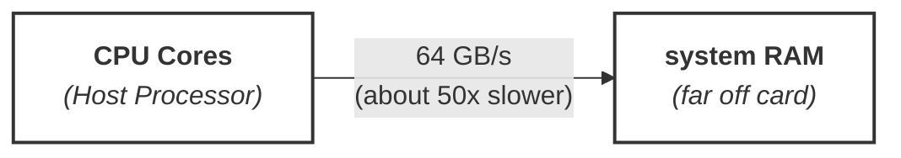
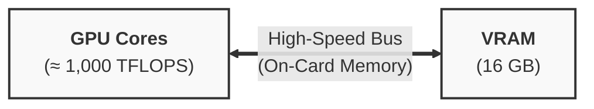

#### Models & Weights

Transformer model is a reusable computer program (the formula), and the weights are millions or billions of adjustable knobs and dials (the numbers).

- The Code (The Transformer Architecture): Written just once by researchers, this is the fixed set of rules or math equations for how text is processed. It never changes.
- The Weights (The .safetensors File): These are billions of specific numbers saved in a file (like llama-3.1-8b.safetensors). They dictate how the model behaves and what it "knows."
- The Result: When you update or swap out the weights, you completely change what the model outputs and what it knows, without needing to rewrite any code.

In short, the transformer architecture is the blueprint, and the weights are the knowledge it has acquired.

CPUs are generalists: They have a few powerful cores (usually 4 to 32) designed to handle sequential tasks, jump between different applications, handle your operating system, and orchestrate everything.

GPUs are massive specialists: They have thousands of smaller cores built specifically to run the exact same math operation simultaneously across massive blocks of data.

AI math is parallelizable: Matrix multiplication—the core engine of neural networks—doesn't need complex logical decision-making, it's just billions of independent multiplications and additions happening all at once.

#### GPU Cores, VRAM, and Bandwidth

There are three numbers that size every AI workloads
- Compute (TFLOPs): How much math a card can perform per second
    - TFLOPs: Trillions of floating-point operations per second
- Memory (GB): How much data a card can hold at once
    - GB: Gigabytes of memory available on the card
- Bandwidth (TB): How much data can be moved in and out of the card per second
    - TB: Terabytes per second of memory bandwidth





| System / Card Type | Compute (TFLOPS) | Bandwidth (TB/s) | Memory (GB) |
| ---                | ---              | ---              | ---         |
| **Desktop**        | 1–3 (CPU)        | 0.09             | 32 (RAM)    |
| **Rack server**    | 5–20 (CPU)       | 0.5              | 512 (RAM)   |
| **NVIDIA A100**    | 312 (GPU)        | 2.0              | 80 (VRAM)   |
| **NVIDIA H100**    | 990 (GPU)        | 3.35             | 80 (VRAM)   |
| **NVIDIA H200**    | 990 (GPU)        | 4.8              | 141 (VRAM)  |

- A chip on its own does nothing at all because something has to drive it.
- Low-level drivers and runtimes (like CUDA) execute instructions on the hardware, while frameworks like PyTorch provide the high-level tools developers use to load models, manage tensors, and orchestrate computations across the GPU cores.

```python
import torch

# Check if a GPU is available
if torch.cuda.is_available():
    device = torch.device("cuda")
    print(f"Using GPU: {torch.cuda.get_device_name(device)}")
else:
    device = torch.device("cpu")
    print("Using CPU")

from transformers import pipeline

generator = pipeline("text-generation", device=0 if torch.cuda.is_available() else -1, model="meta-llama/Llama-3.2-1B")
output = generator("Hello, world!", max_length=50)
print(output)
```